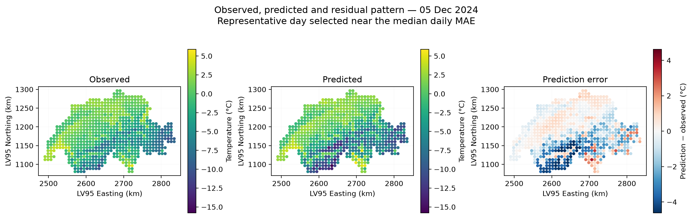

# Next-day temperature prediction across Switzerland

A reproducible SDS320 Spatial Data Analytics project that predicts **next-day daily mean temperature across Switzerland** from recent gridded weather, annual seasonality, spatial location, and elevation.

> **Research question:** How accurately can next-day daily mean temperature across Switzerland be predicted from recent gridded weather, seasonality, spatial location, and elevation?



## Key results

The final model was selected **only on 2023 validation data**, then refit on all pre-2024 observations and evaluated once on the unseen 2024 target year.

| 2024 final test | MAE (°C) | RMSE (°C) | R² | Skill vs. persistence |
| --- | ---: | ---: | ---: | ---: |
| Selected HGB extended + MAE loss | **1.567** | **2.090** | **0.930** | **16.3%** |
| HGB + XY + elevation | 1.643 | 2.169 | 0.925 | 12.2% |
| Linear weather-only | 1.709 | 2.273 | 0.918 | 8.7% |
| Persistence (`tomorrow = today`) | 1.872 | 2.492 | 0.901 | 0.0% |

Additional findings:

- the selected model beats persistence in every month of 2024;
- grid-cell error increases moderately with elevation (`r ≈ 0.48`);
- mean spatial bias is slightly negative, indicating a small tendency to underpredict;
- over four seasonal 7-day benchmark windows, ECMWF TIGGE has MAE 2.084 °C and the ML model 2.120 °C, while the ML model has slightly lower RMSE and higher R²;
- the ML model has lower daily MAE than ECMWF TIGGE on 19 of the 28 sampled benchmark days.

These results describe a **historical next-day prediction experiment**, not an operational replacement for MeteoSwiss or ECMWF forecasting systems.

## Data

The workflow uses three data sources:

1. **MeteoSwiss spatial climate analyses**
   - `TabsD`: daily mean air temperature
   - `RhiresD`: daily precipitation
   - downloaded programmatically as yearly NetCDF files through the Swiss federal STAC catalogue
   - source collection: `ch.meteoschweiz.ogd-surface-derived-grid`

2. **Swiss federal height service**
   - elevation is queried once for each sampled MeteoSwiss grid cell in LV95 / EPSG:2056
   - endpoint: `https://api3.geo.admin.ch/rest/services/height`

3. **ECMWF TIGGE via the Copernicus Climate Data Store**
   - used only as an external historical numerical-weather-prediction benchmark
   - ECMWF control forecast, 2 m temperature, 00 UTC initialization
   - lead times 0/6/12/18 h are averaged to approximate a target-day mean
   - requested on a 0.2° latitude/longitude grid for four seasonal weeks in 2024

The project samples every eighth MeteoSwiss grid cell, leaving **730 valid Swiss grid cells** and **2,660,850 modelling rows** for 2015–2024.

See [`data/README.md`](data/README.md) for acquisition, caching, and data-sharing details.

## Method

### Time split

The split is based on **target date**, not predictor date:

```text
2015-01-09 to 2022-12-31  training targets
2023-01-01 to 2023-12-31  validation / model selection
2024-01-01 to 2024-12-31  final test
```

This avoids a random temporal split and keeps the final year outside model selection.

### Predictors

The final candidate set includes:

- current and lagged temperature;
- 3-day and 7-day temperature summaries;
- current/lagged precipitation and recent precipitation accumulation;
- cyclic day-of-year seasonality (`sin` / `cos`);
- Swiss-wide same-day temperature and precipitation context;
- LV95 easting/northing;
- terrain elevation.

The notebook also tests leakage-safe historical climatology features and residual/delta formulations. These alternatives are retained only if they improve 2023 validation MAE.

### Models

The experiment compares:

- persistence baseline;
- linear regression variants;
- Histogram Gradient Boosting (HGB) with coordinates/elevation;
- extended HGB feature sets;
- MAE-loss and delta-temperature variants;
- climatology/residual variants.

The validation winner is **HGB extended + MAE loss**.

## Spatial evaluation

The project does not stop at a single national metric. It evaluates:

- monthly and daily MAE;
- grid-cell MAE across Switzerland;
- signed spatial bias;
- the relationship between elevation and error;
- permutation importance on 2023 validation data;
- observed/predicted/residual spatial patterns;
- an interactive Leafmap for cell-level inspection.

Important interpretation: the 2024 test measures **future-time generalisation at the sampled locations**. It is not a held-out-region test of completely unseen locations.

## Repository structure

```text
.
├── notebooks/
│   ├── 01_main_project.ipynb
│   ├── 02_ecmwf_benchmark.ipynb
│   └── 03_leafmap_visuals.ipynb
├── src/
│   └── project_utils.py
├── data/
│   ├── README.md
│   ├── raw/                  # downloaded data; ignored by Git
│   └── processed/            # generated caches; ignored by Git
├── models/
│   ├── best_temperature_model.joblib
│   └── selected_model.json
├── results/                  # compact result tables
├── figures/                  # report-ready PNGs + interactive HTML map
├── docs/
│   ├── project_workflow.drawio
│   └── gallery_card.md
├── environment.yml
├── requirements.txt
├── requirements-visualization.txt
├── AI_USE.md
└── README.md
```

## Reproduce the project

### 1. Create the environment

Conda is recommended because the TIGGE notebook uses `cfgrib` / `eccodes`.

```bash
conda env create -f environment.yml
conda activate sds320-weather
```

Alternatively, install the Python dependencies with:

```bash
pip install -r requirements.txt
pip install -r requirements-visualization.txt
```

### 2. Run notebook 01

Run from the repository root or open the project folder in VS Code/Jupyter:

```text
notebooks/01_main_project.ipynb
```

On the first run it automatically:

1. discovers the MeteoSwiss archive assets;
2. downloads TabsD and RhiresD for 2015–2024;
3. samples the Swiss grid at stride 8;
4. queries elevation once per sampled cell and caches it;
5. constructs leakage-safe temporal/spatial features;
6. stores `data/processed/model_table_2015_2024_stride8.parquet`;
7. performs 2023 model selection and the final 2024 evaluation;
8. saves the selected model, metrics, predictions, and figures.

Subsequent runs reuse the processed Parquet cache.

### 3. Configure CDS access for the optional TIGGE benchmark

Create a Copernicus Climate Data Store account, accept the TIGGE dataset terms, and configure the CDS API key in `~/.cdsapirc`. Credentials are intentionally excluded from this repository.

Then run:

```text
notebooks/02_ecmwf_benchmark.ipynb
```

The notebook downloads/reuses 28 ECMWF TIGGE GRIB files and writes the benchmark tables and figures.

### 4. Build the interactive map

Finally run:

```text
notebooks/03_leafmap_visuals.ipynb
```

It creates:

```text
figures/leafmap_2024_error_enhanced.html
```

Open that file in a browser if the notebook frontend does not render the interactive widget.

## Main outputs

### Figures

- `00_input_data_example.png` — temperature, precipitation, and elevation input fields
- `validation_model_comparison_2023.png` — validation-based model selection
- `feature_importance_validation.png` — permutation importance
- `01_model_comparison_2024.png` — final-test model comparison
- `02_monthly_error_2024.png` — monthly model vs. persistence
- `03_daily_error_2024.png` — daily error and 14-day means
- `04_spatial_mae_2024.png` — grid-cell MAE
- `05_spatial_bias_2024.png` — signed mean prediction error
- `06_elevation_vs_error_2024.png` — elevation/error relationship
- `07_observed_predicted_residual_2024.png` — representative spatial residual pattern
- `08_observed_vs_predicted_2024.png` — all 2024 grid-day predictions
- `09_tigge_benchmark_mae.png` — TIGGE benchmark
- `10_tigge_daily_error.png` — daily benchmark behaviour
- `leafmap_2024_error_enhanced.html` — interactive spatial diagnostic

### Tables

The compact CSV outputs in `results/` contain the exact reported model, temporal, spatial, feature-importance, and TIGGE metrics.

## Limitations

- The model is evaluated on future dates at locations represented in training, not on a spatially held-out region.
- MeteoSwiss spatial climate analyses are gridded analyses; the workflow should not be described as a real-time operational forecast pipeline without considering product latency.
- The ECMWF benchmark covers four selected seasonal weeks, not all of 2024.
- TIGGE has a much coarser grid than the MeteoSwiss analysis, and its target-day mean is approximated from four instantaneous forecast lead times.
- Permutation importance should not be interpreted causally, especially where predictors are correlated.
- Grid subsampling makes the experiment computationally manageable but does not retain every native ~1 km MeteoSwiss cell.

## Data attribution and documentation

- MeteoSwiss spatial climate analyses: https://www.meteoswiss.admin.ch/services-and-publications/applications/ext/climate-data-spatial.html
- Swiss federal data/STAC catalogue: https://data.geo.admin.ch/
- Swiss federal point-height API: https://docs.geo.admin.ch/access-data/get-point-height.html
- Copernicus Climate Data Store API: https://cds.climate.copernicus.eu/how-to-api
- TIGGE terms/licence: https://cds.climate.copernicus.eu/licences/tigge-licence

No third-party raw weather or elevation data are redistributed in this repository. Users should follow the relevant provider terms when reproducing the analysis.

## AI use

AI-assisted work is documented transparently in [`AI_USE.md`](AI_USE.md). AI tools supported debugging, code review, visualisation refinement, repository organisation, and discussion of modelling choices. Reported results come from executed project code and saved outputs, not generated values.
